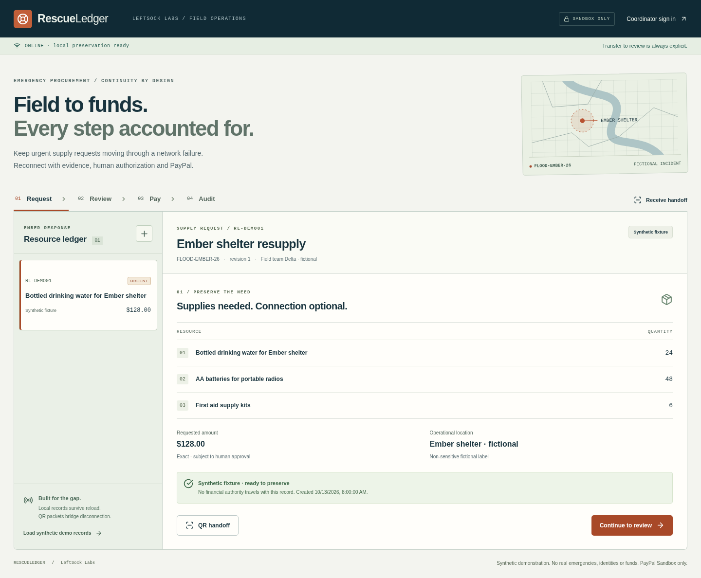

# Waylatch

**Offline-ready emergency procurement and accountable payments.**

From field need to verified action. Formerly RescueLedger; original history and compatibility identifiers are retained.

Waylatch preserves emergency resource requests offline, moves them between devices through bounded QR packets, assists a coordinator with real local semantic review, and gates PayPal Sandbox purchases behind human review and explicit authorization. A reconciled capture is linked to its approved request and a tamper-evident event history.

Built by Colby Weiss / LeftSock Labs for the PayPal AI Hackathon 2026. All incident, organization, identity and expense examples are fictional. This prototype has not been tested in real emergencies. No lending, credit, deferred repayment, real-money transactions or autonomous AI authorization.

**Current limitation:** actual PayPal account integration is blocked by missing cloud Sandbox credentials. The Orders v2 client and guarded workflow execute against clearly labeled local test providers. Real local AI inference, offline reload and QR transfer have been executed. Payouts execution is blocked/unimplemented; claim review and human reimbursement approval work independently. See [verification](docs/VERIFICATION.md).



## Run locally, at no cost

Requires Node.js **24+**, npm, Python 3 (only for the one-time model downloader), and a modern Chromium browser. Node's built-in SQLite stores durable server records without an external database.

```bash
# Unpack the supplied source archive (or clone a future authorized private repository).
cd Waylatch
ONNXRUNTIME_NODE_INSTALL_CUDA=skip npm ci
cp .env.example .env
```

Configure `.env` locally or use securely bound runtime environment variables:

- `COORDINATOR_PASSWORD`: a strong, unique passphrase of at least 12 characters; no default is supplied. Generate one with `openssl rand -hex 24` and set it locally. Do not commit it or paste it into chat.
- `APP_ORIGIN=http://127.0.0.1:4173`, `PORT=4173` (default).
- `DATABASE_PATH=data/rescueledger.sqlite` (ignored durable SQLite file).
- `PAYPAL_CLIENT_ID` and `PAYPAL_CLIENT_SECRET`: **Sandbox application credentials only** from the PayPal Developer Dashboard. Optional until real payment testing. Never use live credentials.
- `PAYPAL_WEBHOOK_ID`: optional until a real Sandbox webhook subscription and public HTTPS callback exist. Missing configuration rejects notifications.

```bash
npm run model:download   # pinned free model assets, ~24 MB; no inference service
npm run build
npm start
```

Open **http://127.0.0.1:4173**. Sign in with the locally configured coordinator passphrase. For development, `npm run dev` runs Vite on port 5173 and the backend on 4173; set `APP_ORIGIN=http://127.0.0.1:5173` while using that UI. Default backend remains loopback only. The production build supplies the offline service worker; use the production URL for offline acceptance testing.

The CPU install flag avoids unnecessary CUDA downloads. If behind a proxy, keep inherited HTTPS_PROXY and CA trust. Start/probe scripts enable Node's supported environment proxy handling; no TLS-verification bypass. The model downloader uses Python's proxy-aware HTTPS path, pinned revision and asset hashes.

## Repeatable product story

1. Click **Load synthetic demo records** to preserve three fictional examples in IndexedDB. The initial single preview is labeled a synthetic fixture until preserved/uploaded.
2. Create a **New field request** with incident, resource/quantity, urgency, amount certainty, origin and optional non-sensitive location. Blank optional values remain explicitly unknown. Claims additionally record an incurred-at timestamp and receipt digest. A receipt file can be SHA-256 hashed locally; only its digest enters the record and no image is uploaded.
3. After the app has loaded online once, disable browser networking. Preserve a request and fully reload; it survives. A first-ever visit cannot load an uncached web app.
4. **QR handoff** generates RL1 packets at most 600 raw bytes each. On a second preloaded browser/device, choose **Receive handoff** and import QR photos/screenshots (or packet text/file). Scan every packet to finish; missing fields and duplicate counts remain visible. Partial receiver state survives reload. Reset starts a separate request session. There is no live camera streaming scanner; mobile image input can use the camera.
5. Sign in on the coordinator, reconnect, and explicitly **Send to coordinator review**. Reconnection does not upload or purchase automatically. QR provenance is retained; every import is unreviewed on the server.
6. Upload a comparison request/claim and click **Run local semantic review**. The panel says **Real local AI inference** only after embeddings execute. Reasons include incident, amount, receipt digest, temporal proximity and semantic similarity. Cosine is not a fraud probability. Without local model assets/runtime, the panel explicitly says **Deterministic indicators only**.
7. Record a review note and human disposition. In **Pay**, explicitly authorize the exact request revision/amount. Unknown quantities, incident or estimated amount block authorization. To revise a local draft, create a new request; wire-level revision support exists but an edit/revision UI is not implemented yet.
8. With Sandbox credentials configured, create the order, open its PayPal **Sandbox** buyer approval link, sign in as a Sandbox **personal buyer** distinct from the merchant, return, and explicitly confirm capture. The server inspects authoritative approval, order reference, currency and amount. Order creation remains unpaid. Interrupted capture is reconciled before any retry.
9. **Audit** validates the SHA-256 chain and exposes event/transaction references. Export JSON and independently validate it with `npm run audit:validate -- path/to/export.json`.
10. Select the separate claim, run review, and record reimbursement approval. **Payouts unavailable · entitlement unverified** remains visible. No payout success is invented and no Payouts API is called by the UI.

IndexedDB belongs to the browser profile/origin; private/incognito storage may be deleted by the browser. SQLite durability requires retaining `data/` and its write-ahead log during operation. This prototype supports one backend process per database.

## Verification commands

```bash
npm test                 # schemas, packets/persistence, AI signals, payment/auth/retries/audit
npm run build            # TypeScript + production Vite bundle
npx playwright install chromium
npm run test:e2e         # browser offline/QR + real AI + claims + axe; model assets required
npm run test:ai          # actual local model benchmark; assets required
npm run release:check    # bounded local credential/bundle scan; not certification
npm run paypal:auth      # sanitized OAuth-only gate; blocked exit2 without secure bindings
npm run paypal:probe     # one Sandbox Payouts entitlement probe; blocked exit2 without keys
npm run paypal:integration
```

`paypal:integration` requires the app running with the same secure configuration. It goes through authenticated server upload/review/approval, prompts for explicit `REVIEW` before recording human review, then explicit `AUTHORIZE`, creates an actual Sandbox order, prints its approval URL, and prompts for explicit `CAPTURE` after browser buyer approval. Success requires authoritative COMPLETED order + capture references, then writes sanitized `docs/evidence/paypal-real-sandbox.json`. **No such success file exists yet.** This harness is loopback-only; do not substitute a provider double for real evidence.

`paypal:probe` posts a one-cent **Sandbox-only** payout to a fictional `example.com` receiver with a fixed sender batch ID. Run once per configured account to test entitlement, inspect actual response and retain evidence. No real money is involved. A successful probe alone does not implement a reimbursement flow. Prioritize Orders capture before unlocking Payouts.

The four HTTP simulator tests start a separate local process and exercise OAuth/Orders/capture/verification over localhost. They verify contract behavior and interrupted responses, **not a real PayPal integration**. No simulator configuration is exposed by the production server.

If Chromium reports missing system libraries, install Playwright's OS dependencies in your own authorized development environment (`npx playwright install-deps chromium`). Tests use synthetic passphrases and isolated database filenames, never your real credentials.

## Webhooks

Subscribe a **Sandbox** app to `PAYMENT.CAPTURE.COMPLETED` and configure a publicly reachable HTTPS URL ending `/api/webhooks/paypal`, then securely set that subscription's webhook ID. The server calls the official signature-verification API before accepting an event. Delivery IDs persist; reconciliation failures remain retryable. Authoritative order inspection still controls payment status. Local invalid-signature and verified-provider-double tests are clearly separated from actual signed callback receipt. No public HTTPS callback is currently configured.

## Architecture and release documents

- [Architecture](docs/ARCHITECTURE.md), [implementation checklist](docs/IMPLEMENTATION_PLAN.md), [durable project state](docs/PROJECT_STATE.md)
- [Security model](docs/SECURITY_MODEL.md), [offline protocol](docs/OFFLINE_PROTOCOL.md), [AI model and benchmark](docs/AI_MODEL.md)
- [Verification evidence](docs/VERIFICATION.md), [blockers](docs/BLOCKERS.md), [Sandbox integration runbook](docs/PAYPAL_SANDBOX_INTEGRATION.md)
- [Rebrand and compatibility](docs/REBRAND_HISTORY.md), [name investigation](docs/WAYLATCH_NAME_CLEARANCE.md)
- [Official hackathon requirements](docs/HACKATHON_REQUIREMENTS.md), [CrisisCodec adaptation](docs/CRISISCODEC_REUSE.md)
- [Demo script](docs/DEMO_SCRIPT.md), [submission text](docs/DEVPOST_DRAFT.md), [release checklist](docs/RELEASE_CHECKLIST.md)

The authentic implementation history is synchronized to the private repository https://github.com/Ledgercorp/Waylatch. The original `feat/rescueledger-mvp` branch and recovery archives remain preserved. Public visibility is not authorized.

Root license adoption is **pending owner approval**. `docs/LICENSE-MIT-PROPOSAL.txt` is a proposal and does not license this private repository. CrisisCodec code was selectively adapted with the owner's authorization; its original source also has no adopted root license. Dependencies/models retain their own notices. Do not change visibility or submit until ownership, license, public release and final submission approvals are complete.

## Private release preparation

The current engineering checkpoint adds a callback-only gateway, a $1.00 fictional Sandbox integration fixture with unchanged human prompts, a complete lockfile/native-dependency license inventory, and a recorded [1:50 captioned engineering preview](docs/demo/waylatch-engineering-preview.mp4). The preview uses actual app footage and visibly labels automated review fixtures, simulated disconnection and blocked PayPal checkout. It is not a final financial demonstration.

The [submission package](docs/submission/SUBMISSION_PACKAGE.md) includes prepared Devpost fields, technology tags, an exportable architecture SVG, screenshot captions, narration/editing instructions and release gates. No Devpost project, YouTube upload, public repository, root license adoption or final submission has been performed. Naming remains AMBER. See [license audit](docs/LICENSE_AUDIT.md) before redistribution.

For secure callback testing, start the existing coordinator backend locally and run `npm run webhook:gateway`. Any approved free tunnel must target **127.0.0.1:4180**, never the coordinator port. Only POST /api/webhooks/paypal is forwarded; official Sandbox verification still runs on the backend. The attempted Quick Tunnel failed with a TCP connection refusal and produced no public endpoint or real callback. This receiver is a narrow prototype test boundary, not a production ingress service.

This runtime lacks both required PayPal variables. [Cloud continuation](docs/CLOUD_CONTINUATION.md) records the exact fresh-task handoff using the published Waylatch environment. Do not paste credentials into chat. The integration harness still requires REVIEW, AUTHORIZE and CAPTURE from an actual operator; demo recording scripts disable PayPal and do not satisfy that human requirement.
