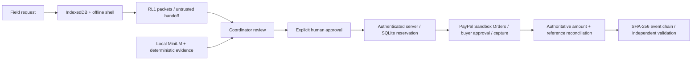

# Waylatch engineering specification

Purpose: preserve disconnected emergency supply requests and make immediate human-authorized Sandbox purchases accountable. Synthetic demonstration only; no emergency deployment claim. No credit, lending, advances, autonomous financial authorization, live PayPal, or paid infrastructure.

React/TypeScript/Vite supports Request → Review → Pay → Audit. Field records and receiver fragments persist in IndexedDB. A service worker caches the shell. Explicit upload on reconnection never purchases automatically. MessagePack/CRC32 QR packets are untrusted transport, not authentication. All reconstructed records require new server-side human review.

Node 24 / Express uses built-in SQLite for durable requests, approvals, payment attempts, sessions and hash-linked audit events. Same-origin HttpOnly sessions with coordinator passphrase protect reads and mutations; financial operations require explicit review and purchase approval for the frozen record revision and exact USD cents. Return URLs are configured server-side. Sandbox-only PayPal REST OAuth → Orders v2 → browser approval redirect → authoritative inspect/capture. Stable PayPal-Request-Id values persist across retries. Uncertain operations reconcile before retry; no order-created state becomes paid. Official verification API gates webhook state changes.

AI: pinned Apache-2.0 MiniLM ONNX weights, Transformers.js CPU inference local to server after predownload; evidence reasons combine semantic cosine similarity with deterministic signals. No probabilities or accusations. Offline field capture does not depend on the model. Claims have a separate review workflow; payouts stay disabled until entitlement evidence and implementation exist.

Boundaries: src/requests/schema.ts shared strict request types; src/offline packet/reconstruction/storage; src/risk semantic evidence; server/paypal.ts provider; server/store.ts SQLite and atomic audit; server/payments.ts state machine; server/app.ts auth and routes; src/components UI stages. Optional research cannot affect payments.

Verification: schema/packet corruption and revision cases; API authorization/amount tampering/concurrency/restart; audit corruption; real model benchmark; browser offline reload, QR across contexts, mobile/desktop accessibility. Real PayPal capture and public webhooks need credentials/HTTPS and cannot be claimed from stubs.

## Request to verified action

Waylatch continues the original RescueLedger architecture. Browser branding does not migrate wire/storage/event identities. Model data never goes to an external inference API. Current actual account integration depends on secure runtime credential bindings; diagrams describe the implemented workflow, not completed real-provider evidence.

## Callback-only ingress and release tooling

`server/webhook-gateway.ts` and `scripts/webhook-gateway.ts` provide a separate loopback test listener exposing only POST /api/webhooks/paypal. It forwards bounded raw JSON and PayPal signature headers to the existing backend, never coordinator cookies or authorization. No additional financial authority, state store or mock-provider production mode is introduced. Signature verification, persistent deduplication and authoritative reconciliation remain in app/payments/store. The optional tunnel targets this listener; tunnel provisioning is currently blocked.

`demo:record` starts an isolated loopback application with a unique SQLite database, disabled PayPal credentials and labeled automated local fixtures. `demo:render` converts actual recordings to captioned H.264 and verifies duration. The original diagram export is submission/architecture.svg. None of this changes RL1, IndexedDB identities, historical event hashes, model configuration or the payment state machine.

## Server credential compatibility

server/paypal-config.ts is the shared server-only environment resolver used by startup and all provider scripts. It prefers nonempty PAYPAL_CLIENT_SECRET and otherwise accepts PAYPAL_SECRET_KEY. It does not mutate process state, alter the payment provider host, expose values to the frontend or confer authorization. Existing API, packet, storage, payment reservation and audit contracts are unchanged.
