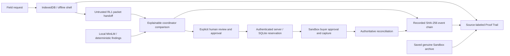

# Waylatch engineering specification

Waylatch preserves disconnected supply requests and connects advisory review to explicit human-authorized Sandbox purchases and recorded accountability. It continues the existing RescueLedger history and storage identities. The application is a synthetic prototype; no emergency deployment, credit, lending, autonomous authorization, live PayPal or paid infrastructure is claimed.

## Existing workflow and competitive additions

React/TypeScript/Vite now presents Request → Review → Pay → Proof → Audit. IndexedDB retains field requests, import provenance and partial receiver fragments. A service worker caches the production shell. Reconnection does not upload or purchase automatically. RL1 MessagePack/CRC32 packets remain bounded, untrusted transport; CRC checks are not sender authentication. Unknown fields and original wire/storage identities remain compatible.

The explainable comparison layer renders two descriptions, exact matching/differing terms and receipt/reference, amount, incident, timing and missing/conflicting context. Semantic cosine evidence is distinguished from deterministic findings. `src/risk/comparison.ts` derives presentation evidence without changing model scores or payment state. Authenticated `POST /api/requests/:id/relationships` checks both revisions and records `pair_disposition_recorded`; related/unrelated/investigate outcomes remain advisory.

`src/proof/trail.ts` assembles recorded request metadata, local browser provenance, server audit events and optional archived provider evidence. `ProofTrail.tsx` renders chronology, sources, statuses, evidence gaps and export controls. It never invents missing offline, QR or buyer events. The browser reports supplied server validation; it does not recompute event hashes. Sanitized report summaries omit private audit content and are not original hash preimages. A separate original complete organization chain preserves event bodies, ordering and SHA-256 links for independent CLI validation, with a privacy warning. Filtering interleaved organization events by request would break chain scope and is not presented as independent chain proof.

## Server and financial authority

Node 24 / Express and built-in SQLite persist requests, approvals, reservations, sessions and audit events. HttpOnly same-origin coordinator sessions protect operational reads and mutations. Financial operations require human review and purchase approval for a frozen revision and exact USD cents. Return URLs belong to server configuration. Orders v2 creation, buyer approval, authoritative inspection and capture remain Sandbox-only. Stable PayPal-Request-Id values survive retries; uncertain outcomes reconcile before new action. Order creation alone never means PAID. Official signature verification gates webhook state changes.

AI does not authorize, reject or capture payments. Claims retain a separate review workflow; actual reimbursement transfer is unimplemented and Payouts entitlement is unverified.

## Local AI and evaluation boundary

The pinned model remains Xenova/all-MiniLM-L6-v2, revision `751bff37182d3f1213fa05d7196b954e230abad9`, q8 ONNX, CPU, 384-dimensional embeddings. Seven asset sizes/hashes remain in `src/risk/model-assets.ts`. Transformers.js uses local verified files; descriptions do not go to an external inference API. Existing request/model bounds remain. Field-browser offline preservation does not require model inference.

The original 12-pair calibration is retained. The new 240 fictional scenarios and model-blind AI annotations support separate 80-case calibration and 160-case held-out evaluation by supply family. `scripts/evaluate-ai.ts` implements calibration → freeze → held-out fingerprints, three baselines, confusion metrics, latency and uncertainty. New calibration is blocked by missing pinned files and proxy CONNECT 403; metrics are null, freeze/held-out have not executed and no performance gain is claimed. Labels are independent AI-review annotations, not human-expert or field truth.

## Isolated judge workspace

`npm run judge` invokes `scripts/judge-start.mjs`: Node-version check, dependency/bootstrap compilation as needed, then `scripts/judge-demo.ts`. It verifies/downloads the unchanged pinned model and uses a fresh temporary database, random private coordinator passphrase, fictional records and a blocked provider. Existing accounts and historical payment database are not opened or changed. Merchant credentials are stripped. The loopback judge-session endpoint checks exact host/origin; normal authentication gates remain unchanged outside judge mode.

`npm run judge -- --evidence-only` is an explicit limited option that skips model setup and labels deterministic-only review. It is not an AI simulation. `GuidedDemo.tsx` explains offline reload, QR handoff, review, human authority, the separate historical archive and Proof Trail. Judge mode blocks financial approval, order/capture, provider inspection and webhook operations.

`server/judge-demo.ts` validates and whitelists the saved provider/archive inputs. The original seven-event chain and independent saved provider checks establish the historical USD1.00 simulated purchase; the archive is read-only and does not make a new provider request. Actual historical REVIEW/AUTHORIZE/buyer/CAPTURE decisions remain separate from walkthrough data.

## Verification and limitations

Controlled provider doubles verify interrupted responses and store reopen recovery without external calls. New bounded store/codec measurements retain raw samples and memory-backed filesystem limitations in `docs/RESILIENCE_COMPETITIVE.md`. New real Chromium evidence-only checks cover offline reload, receiver persistence, comparison, responsive Proof Trail and exports. These do not establish new genuine model inference, real callback delivery, physical-disk power-loss durability or accessibility certification.

The original actual Sandbox purchase and seven-event audit remain unchanged. Hash links detect alteration relative to known hashes but cannot prevent complete administrator rewrites or reveal deletion of an unanchored tail. This is not a blockchain.

## Callback ingress and credential compatibility

The separate callback-only gateway exposes bounded POST `/api/webhooks/paypal` and forwards raw JSON/signature headers without coordinator cookies. Existing verification/reconciliation/deduplication remains authoritative. Genuine delivery remains unverified.

`server/paypal-config.ts` prefers nonempty PAYPAL_CLIENT_SECRET and accepts PAYPAL_SECRET_KEY as fallback. It stays server-only and does not modify credentials, host or approval requirements. This phase makes no PayPal purchase or credential change.
